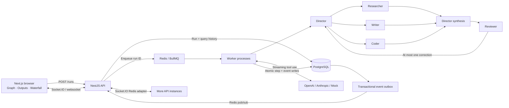

# AI Agent Orchestrator

A small, observable multi-agent system. Give it a task, watch a Director delegate to specialists, and inspect the complete execution: streamed output, delegation graph, trace waterfall, tokens, cost, and review decisions.

Built as a weekend-sized portfolio MVP with **NestJS 11**, **Next.js 15 / React 19**, **PostgreSQL / TypeORM**, **Redis / BullMQ**, and **Socket.IO**. OpenAI and Anthropic adapters share the same orchestration path as a deterministic, key-free demo.


The recording shows the actual running application in mock mode. The Playwright test also captures desktop and mobile screenshots.

Spanish acceptance guide: [Prueba final de la demo](docs/PROBAR-DEMO.md).

## Browser-only portfolio demo

An additional static build runs the **same orchestration engine and deterministic provider entirely in the browser**, reusing the graph and trace UI. No backend, AI API, keys or cookies are needed. Four examples include a review correction; streamed events, tokens, calculated simulated cost and tab-session history remain available after disconnecting the network once the page has loaded. Reloading clears the session.

```sh
corepack pnpm install --frozen-lockfile
corepack pnpm build:demo
```

Upload the contents of `apps/demo/dist/` (including `.htaccess`) to the **danielgil.eu** document root under `/demos/orchestrator/`. Build size is about **0.17 MB gzip**; the locally measured cold 4G median to UI/graph ready is **2.09 seconds** (1.6 Mbps, 150 ms latency, CPU ×4). These are lab measurements, not Raiola field results. [Exact iframe HTML, FTP instructions, security fallback and verification](docs/STATIC-DEMO.md). The full API/worker application below remains a separate supported deployment.

## Run it

Prerequisite: Docker with Compose v2.

```sh
docker compose up
```

Open [localhost:3000](http://localhost:3000). API health: [localhost:4000/health](http://localhost:4000/health).

No `.env` file or API keys are required. Compose builds the applications, waits for PostgreSQL and Redis, applies migrations, then starts the API, worker, and web app. Data survives restarts in named volumes. The initial database is intentionally empty.

Try:

- **Plan a landing page for a coffee shop** — the happy path, normally six calls.
- **Compare Kafka vs RabbitMQ for a real-time game backend** — another deterministic scenario.
- Add **`[retry]`** to a mock task — the Reviewer requests a correction; the Director authorizes exactly one retry.
- Open **Configure agents** to choose each agent’s model and the run budget.
- Set a **$0.001** budget to demonstrate the budget guard. The exact stopping step depends on configured models.
- Reload an active run to demonstrate snapshot + event replay.

The mock produces repeatable scenario content and simulated token usage. It is explicitly labeled throughout the UI. The Researcher does not browse the web; the Coder does not execute generated code.

### Live providers

The five roles default to Claude Haiku 4.5 with a $0.10 run budget, so a single Anthropic key is sufficient for the initial live configuration. See [local Claude configuration](docs/CLAUDE-LIVE.md). OpenAI models remain configurable and require their own key.

Copy `.env.example` to `.env`, set `MOCK_LLM=false`, and supply keys for the providers selected in your agent configuration. Restart with `docker compose up --build`. Provider keys stay in the API/worker environment and are never bundled into the browser.

The allowlisted model IDs live in `packages/shared/src/index.ts`. Prices in `config/model-pricing.json` are **USD per million input/output tokens**. Verify current availability and rates before enabling live billing. Model and pricing configuration are snapshotted into each run. Changing pricing requires rebuilding/restarting the backend.

`NEXT_PUBLIC_API_URL` is a browser-facing build argument. For a non-local deployment, set it and `WEB_ORIGIN` before rebuilding the web image. Browser and server Sentry DSNs are optional; secrets belong in an untracked `.env` or deployment secret store.

## Architecture



### Execution and failure semantics

1. Zod validates a task, agent configuration, and budget. A Redis-backed limit permits ten submissions per client IP per minute.
2. The API stores a queued run and enqueues its ID. A reconciliation loop repairs the gap if the API exits between the database commit and enqueue.
3. A BullMQ worker atomically claims a queued run. The Director must use the `delegate` tool. Tool arguments are validated and bounded to three distinct specialists.
4. Independent specialist calls run concurrently. The Director synthesizes their outputs and the Reviewer calls the `review` tool. A rejection requires a Director `decide_retry` tool decision; only one correction is allowed.
5. Each provider call has its own step, timeout, usage, cost, and status. Transient HTTP 429/5xx failures receive up to two exponential-backoff retries, each visible as a separate step. Partial streamed responses are never automatically replayed.
6. The worker writes step transitions and their events in the same transaction. Token events are briefly batched. An outbox publisher retries delivery to Redis; publication is **at least once**.
7. Each API instance subscribes to the event channel and emits to its **local** run room. This avoids multiplying delivery when all API instances also use the Socket.IO Redis adapter. Clients buffer out-of-order events and deduplicate by sequence.
8. A repeatable-read snapshot includes an event cursor. The browser subscribes from that cursor, joins before replay, and periodically repairs gaps over REST. PostgreSQL is the source of truth; Redis pub/sub is the live transport.

A stalled worker is failed explicitly when BullMQ recovers its job. The MVP does not checkpoint and repeat billable calls automatically. Unknown billing after a worker crash is reported as unknown. Restarting work requires a new run.

### Budget and accounting

The worker reserves a conservative UTF-8 input bound plus capped output tokens **before starting each concurrent call**. It checks provider-reported costs when calls settle and aborts further work when the budget is exhausted. An interrupted call retains its full reservation as a conservative estimate. Rejected HTTP requests are estimated at zero cost.

This is an application guard, not a provider billing guarantee: usage arrives asynchronously, cancellation cannot undo billed generation, tokenization differs by provider, and crash-time billing can be unknown. Prices exclude caching discounts, special service tiers, taxes, and tool charges. Keep a provider-side spending limit as well.

Live counters are labeled estimates. Completed successful calls use reported usage; mock usage is simulated. Cost averages compare the actual agent workloads in matching runs, not a controlled model-quality benchmark.

## Data model

| Table | Purpose |
| --- | --- |
| `runs` | Task, status, agent/model configuration, pricing snapshot, budget, result/error, timing and usage totals |
| `steps` | One provider call: agent, model/provider, input/output, attempt, timing, usage, cost, error, and nullable parent step |
| `run_events` | Ordered events per run, JSON payload, timestamp, and publication marker; also the transactional outbox |

Steps form a tree through `parentStepId`. The graph aggregates that tree into five agents; the waterfall and call selector expose individual calls, including retries and Director synthesis. Monetary columns use `numeric(14,8)`; application/API values use numbers. Runtime event schemas and the browser flow catch serialization regressions.

Indexes cover newest-first `(createdAt, id)` pagination, status/date lookup, model/run lookup, step parents, ordered event replay, and unpublished events. TypeORM `synchronize` is disabled.

## API and events

| Endpoint | Behavior |
| --- | --- |
| `POST /runs` | Validated creation; HTTP 202; IP rate limit |
| `GET /runs` | `status`, `model`, `from`, `to`, `cursor`, `limit` filters; model aggregates use all matching runs, independently of the page |
| `GET /runs/:id` | Consistent snapshot with steps and event cursor |
| `GET /runs/:id/events?after=0` | Up to 2,000 ordered events; continue with the last sequence |
| `GET /health` | PostgreSQL and Redis readiness, plus mock/live mode |
| `GET /health/live` | Process liveness, independent of database/cache |
| `GET /health/ready` | PostgreSQL and Redis checks; HTTP 503 with dependency states on failure |
| `GET /metrics` | Prometheus text format: retained tasks, tokens, USD cost and duration by state and mock/live mode |

Dates use ISO-8601 UTC timestamps. Cursors are opaque base64url `(createdAt, id)` pairs. Invalid inputs return 400; missing runs return 404.

Socket.IO: emit `run.subscribe` with `{ runId, after }`; receive `run.event`. Subscribing switches the socket to that run’s room. The acknowledgement reports success or an error.

Event types: `run.started`, `step.started`, `step.token`, `step.completed`, `step.failed`, `run.completed`. `run.completed` means terminal and carries `completed`, `failed`, or `budget_exceeded`, plus the full run. Each event includes `runId`, monotonic `sequence`, `stepId`, `createdAt`, and a typed payload.

## Local development and checks

Use Node.js 22+ and pnpm 10.28.2. Start PostgreSQL and Redis, then:

```sh
corepack enable
pnpm install --frozen-lockfile
docker compose up -d postgres redis
pnpm --filter @orchestrator/shared build
pnpm --filter @orchestrator/api build
pnpm --filter @orchestrator/api migrate
```

In separate terminals:

```sh
pnpm --filter @orchestrator/api start
pnpm --filter @orchestrator/api worker
pnpm --filter @orchestrator/web dev
```

Local defaults match the Compose database credentials. For custom settings, export variables in your shell (or use Node’s `--env-file` on the API/worker entry points). Next.js reads its app-local env files; Compose reads the root `.env`. Simply copying the root example does not load variables into arbitrary local Node processes.

```sh
pnpm lint
pnpm typecheck
pnpm test
pnpm build
pnpm --filter @orchestrator/web exec playwright install chromium
pnpm test:e2e
```

With the mock stack running, `pnpm demo:check` verifies socket reconnection/replay, a corrective review cycle, a generic task, budget exhaustion, validation, and history pagination. Use `--web-url http://localhost:3107` for an alternate local web port or `--socket-url` to receive events from another API instance. The check refuses to create runs against live providers. `pnpm smoke:compose` verifies the UI and a persisted six-step execution after Compose startup.

The Playwright happy path needs the API, worker, database and Redis running in mock mode. It starts the web development server if necessary. To test an already-running production UI, set `PLAYWRIGHT_BASE_URL`. It verifies submission, live socket connection, reload recovery, reviewed output, the six-step trace, numeric event costs, persisted events, history filtering, and mobile overflow. Screenshots and failure traces are written under `apps/web/test-results`.

Vitest uses mocked providers for delegation, review/correction limits, budget checks, timeouts, transient retry behavior, malformed tools, configurable models, and streaming protocols. No paid API calls are used by CI.

GitHub Actions runs lint, typecheck, unit tests, builds, migrations and Playwright with real PostgreSQL/Redis services. A separate job builds and starts all five Compose services, then verifies the UI and a persisted run. Browser artifacts and container logs are retained even on failure. Linux builds produce Next’s standalone output; Windows builds use standard output because symlinks require Developer Mode.

## Design decisions and trade-offs

- **One explicit orchestration loop.** No agent framework: the state transitions and retry limits stay inspectable and testable in a weekend.
- **Native streaming HTTP adapters.** OpenAI Chat Completions and Anthropic Messages use provider-native tool use, without additional SDK dependencies. SSE handles fragmented UTF-8, CRLF and tool-argument deltas.
- **Persisted traces, lightweight transport.** PostgreSQL holds durable history; Redis handles scheduling and fast fan-out. The outbox closes the commit/publish gap without adding another broker.
- **Fixed specialists, configurable models.** Five roles keep the demo understandable. The Director can choose one to three distinct specialists; the UI exposes every call.
- **WebSocket-only Socket.IO.** This avoids the sticky-session requirement of polling fallbacks; restrictive networks may need a configured reverse proxy.
- **Optional Sentry.** API exception filter, worker reporting, Next request errors, client initialization and a React error boundary are wired. DSN-free operation is supported; prompt/output contents are not added as custom telemetry.
- **Local demo scope.** Compose binds exposed ports to loopback. Authentication, tenant isolation and public-hosting controls are next steps. Do not expose the unauthenticated, billable API directly to the public internet.
- **Deliberately small deployment.** The API image retains build tooling for simplicity. The web runtime is standalone on Linux. Logs and database traces supply observability without adding an observability stack.

## How it scales

- Put **stateless API instances behind a load balancer** supporting WebSocket upgrades. Shared rate limits live in Redis; configure trusted proxy/IP extraction for the actual ingress before deployment.
- The **Socket.IO Redis adapter** coordinates rooms across instances. Application pub/sub deliveries are emitted locally to prevent duplicates multiplying across the cluster. Sequence replay handles duplicates and missed transient publications.
- **Scale BullMQ workers horizontally** and tune `WORKER_CONCURRENCY` against provider limits and the PostgreSQL connection budget. Each job owns one run; bounded parallel specialist calls improve latency without an unbounded fan-out.
- Keep **Postgres indexes** aligned with history filters and cursor ordering. Add connection pooling and partition/archive token events as volume grows. Read replicas can serve historical queries; active snapshots/replay must use a sufficiently consistent source.
- Keep **cost guards and call caps** close to worker execution. Add per-tenant monthly quotas and provider-side spend controls before allowing untrusted traffic.
- Redis runs with AOF and `noeviction`. Terminal BullMQ jobs have bounded age/count retention; durable history remains in PostgreSQL. Production needs managed backups, retention rules, health monitoring and graceful worker draining.

## Next steps

This project is an independent service. Core integration is outside its current scope; there is no pending Core release dependency. `PLATFORM_MODE` is not implemented. The standalone application and browser-only simulated demo are the supported execution paths.

The metrics are persisted-history **gauges**, not monotonic counters: retention can decrease values. Mock costs/tokens are simulated. Multiple API instances expose the same database snapshot, so deduplicate replicas instead of summing them. Duration is a sum in seconds with a separate timed-task count. API health does not assert worker progress. Infrastructure handoff and NAS limitations: [platform-infra additions](docs/platform-infra-additions.md).

CI now includes dependency fault injection and a redacted full-history Gitleaks scan with an injected-secret rejection check. Successful push CI triggers the image workflow: API/worker and web images use the full commit SHA, linux/amd64, disabled attestations, and downloadable Docker archives compressed with plain gzip plus SHA-256. First GHCR publication and NAS loading must be verified before deployment; this repository does not change platform-infra.

1. Authentication, tenant-scoped access, idempotent submission and per-tenant quotas.
2. Durable checkpoints, explicit cancellation, and reconciliation of interrupted provider billing.
3. Provider token-count endpoints, cached-token/tier-aware pricing, and finer usage reconciliation.
4. OpenTelemetry spans linking HTTP → queue → provider calls; export to an external trace backend.
5. Sandboxed tools, sourced research, and a repeatable evaluation set for output quality.
6. Event retention/partitioning, load testing, and multi-instance fault-injection tests.

### Protocol references

- [OpenAI streaming Chat Completions](https://developers.openai.com/api/reference/resources/chat/subresources/completions/methods/create)
- [Anthropic streaming messages and tool deltas](https://platform.claude.com/docs/en/build-with-claude/streaming)
- [NestJS WebSocket adapters](https://docs.nestjs.com/websockets/adapter)
- [Socket.IO Redis adapter](https://socket.io/docs/v4/redis-adapter/)
